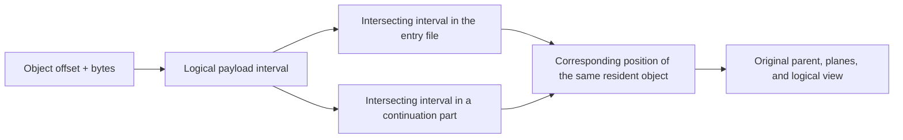

# NInferno v3 Container Specification

V3 stores a compact model-instance configuration, the actual objects, logical bindings, and the required resources. Mathematical formulas, component handoffs, and state programs
are defined by the model code. A reader and a writer can implement file organization and references independently from this document;
the binder of the corresponding architecture then interprets logical parameters and configuration.

An artifact has a fixed entry file and a single global directory. When small, it is one `.ninferno` file; when larger, it consists of the entry file plus continuation parts.
Objects use a unified logical payload offset, and file sharding preserves each object's encoding, layout, and bindings.

## 1. Contract and notation

| Content | Authority |
|---|---|
| File header, JSON, objects and references, file sharding, v3 persistent names | This document |
| Fixed math, compact config, logical parameter shapes, component inputs | The corresponding architecture's [config](../../src/models/qwen3_5/config.h) and [binding](../../src/models/qwen3_5/load/) |
| Numeric decoding of a format, valid codes/scales | [Numeric formats](tensor-formats.md); persistent names are in section 6 |
| Layout planes, packing, internal padding, and encoded size | [Storage layouts](storage-layouts.md); persistent names are in section 6 |
| Native Op parameters, supported ranges, numerics, and scratch | The corresponding Op contract |
| Residency, state, capacity, CUDA Graph, and result publication | [Engine architecture](engine-architecture.md) and its resource contracts |

Integers in this document are exact integers; booleans and floating-point values are interpreted according to their own types.

| Notation | Definition |
|---|---|
| U64 | Integer in `0..18446744073709551615` |
| PositiveU64 | A U64 strictly greater than zero |
| ID | Non-empty UTF-8 string, containing no U+0000, compared exactly by its original character sequence |
| Shape | List of positive integers of length `0..16`; the empty list `[]` denotes a scalar |
| `elements(shape)` | 1 for an empty shape, otherwise the product of the dimensions |
| `[begin,end)` | Half-open interval, closed on the left and open on the right |
| `align_up(x,a)` | `ceil_div(x,a)*a` |

Products, prefix sums, offset additions, and alignment results must lie within the U64 range. Actual I/O and memory consumers check their own
address ranges. The file format uses 64-bit sizes; the actual shape support of an Op is determined by its call entry point.

Header integers are little-endian. JSON uses UTF-8, and member names within each object are unique. Member order, ordinary
string escaping, and JSON whitespace keep their standard JSON meaning. Size fields use JSON integers; real-valued model parameters are stored and parsed
at the precision required by their contract.

Field tables list the complete member set of a generic record and which members are optional. An unlisted generic field is a schema error;
`config` is handed to the architecture for interpretation, and `metadata` and `provenance` are open data objects defined in section 10.

## 2. File set and address space

### 2.1 Entry file and continuation parts

The writer produces the file set from the specified entry output path. When the entry file is `example.ninferno`, the file names are uniformly:

```text
example.ninferno
example.ninferno.part-0001
example.ninferno.part-0002
```

The entry file stores the header, the JSON global directory, and the first payload segment. Each continuation part stores its own small header and the subsequent payload.
The writer names a continuation part `<entry file name>.part-<index>`, where the entry file name includes its original extension; the index equals the part's position in the
`files` table, starting from 1, written in decimal, left-padded with zeros to four digits when shorter than four, and printed in full at four digits or more.
Continuation names are derived automatically by this rule, with no separate naming parameter; the actual file name is written to `files[i].path`.

The user always opens the entry file. The reader locates continuation parts by the file names recorded in the `files` table; the generation naming rule above is not a read-time
validation condition, and any file name in the directory that satisfies the path rules of section 3.3 can be read.

All files in the same set carry the same 16-byte `artifact_id`. It is used to verify that the entry file and continuation parts belong together; the writer should use a new UUID each time
it generates a new file set. It is the container-set identifier; model implementation selection still depends on the architecture and instance parameters.
The header stores the raw 16 bytes; when printed, it may be shown as 32 lowercase hexadecimal characters.

### 2.2 Logical payload

Let `files[i].payload_bytes = B_i`, and define:

```text
P_0 = 0
P_i = sum(B_j, j < i)
payload_bytes = sum(B_i)
```

File i stores `[P_i,P_i+B_i)` of the logical payload. These form an ordered, contiguous set of intervals.
An object's `offset` is always relative to this logical payload; each file's header, JSON, and the alignment region before its payload
are not counted in the logical payload.



An object may span a file boundary. It is still a single object, and its format/layout is computed from the logical start of the whole object.
A shard boundary may also lie inside a plane; reads and copies preserve the original byte order.

### 2.3 Default 32 GB shard limit

By default the writer uses a per-file size limit of **32 GB = 32,000,000,000 bytes**, counting the file header, JSON,
the alignment region before the payload, and that file's payload. Here GB is a decimal unit.

The writer may accept other explicit limits. The limit is a generation policy; the file stores only the actual sharding result, and the reader reads according to the directory.
If `entry_payload_start + payload_bytes <= limit`, the writer produces only the entry file.
When the limit is exceeded, the entry file first holds the first segment, and the remaining data goes into continuation parts in order.

For a given entry_payload_start, the current writer's shard capacities are:

```text
entry_capacity = floor((limit - entry_payload_start) / 4096) * 4096
part_capacity  = floor((limit - 4096) / 4096) * 4096
```

When sharding is needed, first check that the limit is sufficient to hold the header and that both capacities are positive; non-final segments are filled to capacity, and the final segment holds the remaining bytes.
The number of shards is determined by the data volume and the capacities.
This placement keeps the logical start of each segment 4096-byte aligned, which suits direct I/O; the reader's range mapping also accepts
other positive-length segmentations that conform to this specification.

## 3. Binary framing

### 3.1 Entry header

The entry header has a fixed length of 32 bytes.

| Offset | Bytes | Field | Encoding and meaning |
|---:|---:|---|---|
| 0 | 8 | magic | `4e 49 6e 66 65 72 6e 6f`, i.e. ASCII `NInferno` |
| 8 | 8 | json_bytes | Little-endian PositiveU64; length of the complete UTF-8 JSON text (a reader refuses more than 256 MiB) |
| 16 | 16 | artifact_id | Raw bytes of the file-set identifier |

```text
json_offset         = 32
metadata_end        = 32 + json_bytes
entry_payload_start = align_up(metadata_end, 4096)
entry_file_bytes    = entry_payload_start + files[0].payload_bytes
```

The reader verifies the full magic, reads the JSON at `[32,metadata_end)`, and checks that the actual file length equals
entry_file_bytes. `[metadata_end,entry_payload_start)` is the file alignment region, which the writer fills with zeros.

Legal trailing JSON whitespace counts toward json_bytes. The writer may use it to reserve a fixed amount of directory space and then lay out the entry file's
payload capacity; this avoids repeatedly moving the payload when the length of the shard table changes. The reader parses this text as standard JSON.

### 3.2 Continuation part header

The continuation part header is also 32 bytes, and its payload always starts at file offset 4096.

| Offset | Bytes | Field | Encoding and meaning |
|---:|---:|---|---|
| 0 | 8 | magic | `4e 49 6e 66 50 61 72 74`, i.e. ASCII `NInfPart` |
| 8 | 8 | part_index | Little-endian PositiveU64; the corresponding index in the `files` array |
| 16 | 16 | artifact_id | Byte-for-byte identical to the entry file's |

```text
part_payload_start = 4096
part_file_bytes    = 4096 + files[part_index].payload_bytes
```

The writer fills `[32,4096)` with zeros. When opening a continuation part, the reader verifies magic, part_index, artifact_id, and the actual length.
The entry file and continuation parts have different magics; a continuation part participates in reading through the entry file's directory.

### 3.3 File directory

The root field `files` is a non-empty array. Item 0 of the array describes the entry file; the remaining items describe continuation parts.

| Field | Type | Meaning |
|---|---|---|
| path | null for item 0; a string otherwise | Sibling file name relative to the entry file's directory |
| payload_bytes | PositiveU64 | Number of logical payload bytes stored in that file |

```json
[
  {"path": null, "payload_bytes": 31999934464},
  {"path": "example.ninferno.part-0001", "payload_bytes": 4096}
]
```

A continuation part's path is a non-empty file name, taken as its original character sequence; it contains no `/`, `\\`, `:`, `<`, `>`, `"`, `|`, `?`, `*`,
control character (U+0000 to U+001F) or DEL, does not end in a dot or a space, is neither `.` nor `..`, and its part before the first dot,
trailing spaces removed, is no Windows device name (`CON`, `PRN`, `AUX`, `NUL`, `CONIN$`, `CONOUT$`, `COM1`-`COM9`, `LPT1`-`LPT9`, and `COM` or
`LPT` with a superscript 1, 2 or 3, in any case): it names one file in the entry's directory on every platform. Continuation file names are pairwise distinct and differ from the entry file name used for this open. The directory can be moved as a whole.

The numeric example above takes entry_payload_start=65536, so the entry file is exactly 32,000,000,000 bytes.
The actual size of the second file is 8192 bytes.

## 4. JSON global directory

### 4.1 Root record

| Field | Type / requirement | Meaning |
|---|---|---|
| components | Object, required and containing text | The model components actually provided and their compact configs |
| objects | Non-empty Array<ObjectDescriptor>, required | Physical objects, ordered by logical payload offset |
| bindings | Object, required | Mapping from complete logical parameter names to Bindings |
| uses | Array<Use>, required | Compute permissions and auxiliary inputs, expanded per mathematical use site |
| files | Non-empty Array<File>, required | File directory of section 3.3 |
| metadata | Object, optional | Data of section 10, such as the public name |
| provenance | Object, optional | Source, training pairing, and conversion notes |

The framing version already fixes the JSON syntax, and the root record uses the fields above directly. A complete JSON example is in section 12.

### 4.2 Component record

The keys of `components` are component IDs. `text` is the main model; the currently optional components are `vision`, `mtp`, `dflash`, and
`dflash2`. New actual architectures or backends may use the same record structure, with the corresponding compiled code interpreting their IDs and config.

| Field | Type / requirement | Meaning |
|---|---|---|
| config | Object, required | Architecture identifier and a few instance parameters of this component |
| target | Component ID, optional | The target component this component is associated with |
| resources | Object, optional | Mapping from resource roles to resource object IDs; omission means an empty mapping |
| proposal | Object, optional, text only | Optional proposal output representation attached to the main model; see section 9.2 |

Config uses the standard architectures/model_type and reserved fields of the corresponding architecture.
For example, Qwen Text contains architectures, model_type, hidden_size, and so on; Vision uses its own standard
model_type; the current Qwen MTP config needs only architectures, and its geometry is obtained through target.
The source adapter interprets the upstream `text_config`, `vision_config`, and similar groupings, then writes the normalized result into the corresponding component's config;
the component's target, resources, and proposal are placed separately according to the field table of this section.

```json
{
  "config": {"architectures": ["Qwen3_5MTP"]},
  "target": "text"
}
```

A target reference must resolve to the corresponding component, and its mathematical association is checked by the architecture binder. Currently the target of both Vision and spec
is text. The fixed feature-capture positions, state operations, and feature preparation flow are defined by that component's code.

A component declaration means the artifact provides it. Launch options decide which components are enabled for this run; text, the selected components, and their actual shared data take part in
loading. The writer is responsible for the data integrity of the declared components, and the binder checks the mathematical and data requirements of the features selected at launch.

## 5. Physical objects

### 5.1 Tensor object

| Field | Type | Meaning |
|---|---|---|
| id | ID | Object reference name, unique within this artifact |
| kind | `tensor` | Object kind |
| shape | Shape | Logical shape of the stored object, using C-order element coordinates |
| format | ID | Numeric format of section 6 |
| layout | ID | Layout of section 6 |
| offset | U64 | Byte offset of the object's start within the logical payload |
| bytes | PositiveU64 | Number of bytes of the object's complete encoding |
| divisors | PositiveU64 | Optional, defaults to 1. Number of independently quantized source matrices stacked into this plane; each source matrix holds one NVFP4 weight divisor, split evenly over the plane's rows. Values greater than 1 are allowed only for `nvfp4` with `block_scale_k16_m128x4_v1` |

```json
{
  "id": "w.attn.qk",
  "kind": "tensor",
  "shape": [7168, 5120],
  "format": "q4_g64_fp16",
  "layout": "row_split_k128_v1",
  "offset": 0,
  "bytes": 19496960
}
```

Shape describes the object's logical value domain; the layout computes its own physical padding, planes, and encoded size.
For example, the K-dimension padding of Q4 is computed by row_split_k128_v1. An object may hold multiple projections or multiple experts;
their mathematical use is given by the bindings of section 7.

An encoded object contains all planes and object-level scalars required by its codec/layout. In the existing NVFP4, the block
scales and weight divisor are inside the object; in the existing per-row FP8, the row scales are also inside the object.
The independent pointers an Op needs are obtained from this object's established layout. The activation divisor at a use site is bound separately; see section 8.

### 5.2 Resource object

| Field | Type | Meaning |
|---|---|---|
| id | ID | Shares one unique namespace with all tensor/resource objects |
| kind | `resource` | Object kind |
| encoding | `raw_bytes_v1` | The whole interval consists of raw resource bytes |
| offset | U64 | Byte offset in the logical payload |
| bytes | PositiveU64 | Raw resource length |

```json
{
  "id": "r.chat_template",
  "kind": "resource",
  "encoding": "raw_bytes_v1",
  "offset": 19496960,
  "bytes": 4096
}
```

How a resource is interpreted is determined by its usage role. The content rules of JSON, UTF-8 templates, or other resources belong to the corresponding Frontend;
the resource object itself provides only raw bytes.

### 5.3 Object ranges and sharing

All objects are ordered by increasing offset, have unique IDs, and their byte intervals do not overlap and lie within the logical payload.
A tensor offset satisfies the layout's 256-byte object alignment, and the alignment of a raw resource is 1.
Tensor bytes equals the encoded size for the corresponding `(format,layout,shape)`.

Gaps between objects and unreferenced logical payload bytes at the end have no load semantics. A conventional writer leaves empty space only for alignment and truncates at the end of the last
object. Padding inside a fully encoded object continues to follow its layout contract.

When multiple logical uses share one object, they all reference the same ID; the materializer builds a single backing from this.
Objects not referenced by the uses of this run remain non-resident. Object IDs, ordering, and file positions take part only in loading and diagnostics; the
weight references used during execution are resolved once by the binder.

A complete parent is the unit of materialization and residency. The converter must organize backbone parameters, the private parameters of each independently enableable component, and the private data of
independently selectable proposal representations into separate objects, so that the private data of disabled features stays non-resident.
Genuinely shared data may be referenced by different features through the same object, for example Text and MTP using the same embedding/head,
or a proposal referencing an existing representation of the Text head.
Concatenating Text parameters and MTP private projections into one parent does not conform to this generation rule; placing their independent objects
in the same file does conform. The converter checks object-merge boundaries against the architecture's feature dependencies, while the reader keeps reading according to the directory.

## 6. V3 numeric format and layout names

### 6.1 Numeric formats

The canonical V3 names use lowercase snake_case. Each name points to a codec in the code with an exact meaning; the fixed
group size, scale type, and decoding rules are defined directly by that codec.

| Name | Numeric meaning |
|---|---|
| bf16 | Raw Bfloat16 word |
| fp32 | Raw IEEE binary32 word |
| int32 | Signed 32-bit integer |
| q4_g64_fp16 | Signed 4-bit codes, G64, FP16 multiplier |
| q5_g64_fp16 | Signed 5-bit codes, G64, FP16 multiplier |
| q6_g64_fp16 | Signed 6-bit codes, G64, FP16 multiplier |
| q8_g32_fp16 | Codes `[-127,127]`, G32, FP16 multiplier |
| nvfp4 | E2M1 codes, G16 E4M3FN block scale, FP32 weight divisor |
| fp8_e4m3fn_row_bf16 | E4M3FN codes, one BF16 multiplier per row |

The FP16/BF16 at the end of a quantization name denotes the scale type. Activation compute permissions are expressed in uses.
Code ranges, special floating-point values, rounding, and exact reconstruction are interpreted per the [numeric contract](tensor-formats.md).
In particular, NVFP4 reconstruction uses `code_value * block_scale / weight_divisor[floor(row / (N / divisors))]`, and per-row FP8 uses its established
`code_value * row_scale` reconstruction rule.

When the encoder or calibration process changes for the same numeric meaning, the format name stays the same, and the generation method is recorded in recipe/provenance.

### 6.2 Layouts and resource encoding

| Name | Currently allowed format / shape | Object alignment |
|---|---|---:|
| contiguous_le_v1 | bf16/fp32/int32, rank 0..16 | 256 |
| row_split_k128_v1 | q4_g64_fp16, q5_g64_fp16, q6_g64_fp16, q8_g32_fp16, positive rank-2 `[N,K]` | 256 |
| block_scale_k16_m128x4_v1 | nvfp4, `K%64=0` (the scale plane is stored in whole 128-row blocks, with the shortfall of the last block zero-padded) | 256 |
| row_scale_v1 | fp8_e4m3fn_row_bf16, positive rank-2 `[N,K]` | 256 |
| raw_bytes_v1 | Resource, non-empty byte string | 1 |

Byte packing, planes, internal padding, swizzle, and the encoded-size formula are defined by the
[storage layout contract](storage-layouts.md).

The v1 of a layout is the layout's own version, managed separately from container v3. Adding a different byte arrangement adds a corresponding layout
definition; adding an actual numeric encoding capability adds a codec definition, and ordinary object records continue to use the same structure.

## 7. Logical parameter bindings

### 7.1 Two kinds of Binding

The root `bindings` is a mapping from complete logical parameter names to Bindings. Names are defined by the architecture code, for example
`text/layers/3/attention/query`. Logical parameter shapes are derived from the code and the compact config.
Each logical name corresponds to exactly one Binding. The architecture defines distinct logical names for trained-parameter uses that need independent representations;
the Bindings may reference the same object or different objects, and the training-sharing relationships are defined by the architecture/config.

A Binding has two mutually exclusive forms:

| Form | Complete fields | Meaning |
|---|---|---|
| Whole object | `object: ID` | A whole tensor object corresponds to one logical parameter; object.shape equals the parameter shape |
| Ordered parts | `parts: non-empty Array<Part>` | Logical elements of the parts are concatenated in order, covering the parameter's C-order element sequence |

The complete fields of a Part are:

| Field | Type | Meaning |
|---|---|---|
| object | Tensor object ID | Physical parent of the part |
| range | `[U64,U64]` | Flattened interval `[begin,end)` of the object's logical elements |

Range satisfies `0<=begin<end<=elements(object.shape)`. The sum of the parts' element counts equals the number of elements of the logical parameter.
Array order is the target element order; the target offset is obtained by accumulating the lengths of the preceding parts.
Intervals of the same object may be referenced by different uses or different parts; the actual meaning of any repetition is interpreted by the corresponding model mathematics.

```json
{
  "text/final_norm": {"object": "w.final_norm"},
  "text/layers/3/attention/query": {
    "parts": [{"object": "w.attn.qk", "range": [0, 31457280]}]
  }
}
```

**The unit of Range is logical elements, while the unit of object.offset/bytes is bytes.** The logical element sequence excludes the padding introduced by the
layout, and does not treat quantization scales as weight elements. It keeps the parent's numeric decoding rules.

### 7.2 Axes, reshape, and row order

C-order means the last dimension varies fastest. For shape `[N,K]`, element coordinate `(n,k)` corresponds to `n*K+k`.
A contiguous run of whole rows `[r0,r1)` therefore corresponds to range `[r0*K,r1*K)`.

The whole-object form expresses a complete binding of identical shape. The ordered-parts form interprets the target shape through an explicit element mapping,
and can express contiguous reshape, sub-regions of a fused parent, split objects, and row-block reordering.
For example, an expert interval of a rank-2 expert bank can correspond to a rank-2 logical projection; higher-rank logical axes are interpreted by
the parameter's own shape.

If a parent stores two groups of projections interleaved, the converter can write Parts in order for each head's contiguous region.
Conventional artifacts prefer to prepare, at conversion time, the grouping and row order that existing Ops consume easily.

### 7.3 Binding to native Ops

The binder checks logical coverage and correspondence, and keeps each Part's parent, original shape, format/layout,
range, and owner. A logical parameter may consist of multiple representations; a native Op may also consume multiple logical parameters.

For example, when Q/K and gate/V come from q4 and q5 parents respectively, parameter preparation can go to the implemented dual-weight entry point; when all four
come from the same nvfp4 parent, it can go to the corresponding single-weight entry point. The code organizes these calls according to the real grouping, ranges, and geometry.

A zero-copy view is determined by the actual layout and the consumer's addressing capability. A span of logical rows in RowSplit involves multiple plane intervals such as base,
optional high-bit, and scale; an NVFP4 view also retains the original parent's scale swizzle and
weight divisor. The materializer uploads the parent's raw encoding, and the Op prepares the view it can actually consume.
Work that changes packing or reorganizes the encoding is done by the converter.

File sharding affects only how parent bytes are fetched. Even when a parent spans multiple files, the logical references and Op parameter relationships above
still hold.

## 8. Use permissions and auxiliary inputs

The root `uses` is an array of Uses, and each `(parameter,input)` combination is unique.
Each Use consumes the Binding that its parameter points to; multiple Uses of the same parameter share that representation,
and each provides the permission and auxiliary values for its own input position.

| Field | Type / requirement | Meaning |
|---|---|---|
| parameter | ID, required | Name of an existing logical parameter in the root bindings |
| input | ID, required | Complete mathematical input position, defined by the architecture code |
| activation_policy | Enum, optional | Required for uses that have this permission contract |
| auxiliaries | Object, optional | Mapping from auxiliary-input roles to Bindings; omission means empty |

The exact spellings and allowed sets of the permission are:

| activation_policy | Allowed set |
|---|---|
| A16Only | A16 |
| AllowA8 | A16, A8 |
| AllowA4 | A16, A8, A4 |

The writer writes an explicit result for every projection use site that requires a permission. An encoder's default rules belong to the recipe, and
are already expanded once they enter uses. When one activation quantization is shared, the intersection of the permissions of the uses involved is taken, and the auxiliary-input relationships are satisfied.

```json
{
  "parameter": "text/layers/3/attention/query",
  "input": "text/layers/3/mixer_input",
  "activation_policy": "AllowA4",
  "auxiliaries": {
    "activation_input_divisor": {"object": "a.attn.query.input_divisor"}
  }
}
```

In this example the auxiliary object is `format=fp32, layout=contiguous_le_v1, shape=[]`, and its value is checked to be positive and finite
as the consumer requires. A Part may also reference a single element of an FP32 vector, retaining the same scalar meaning.
The expected shape, type, and role of an auxiliary Binding are defined by the corresponding use contract.

The query K/V of DFlash/DFlash2 use `attention/key` and `attention/value`, and the context K/V use
`attention/context_key` and `attention/context_value`, each establishing its own Binding and Use.
The two groups of bindings may share a parent region or select representations independently; see section 12.5.
The weight divisor and block scales belong to the weight codec, while the activation divisor belongs to the use site.

## 9. Resources and optional output representation

### 9.1 Frontend resource references

The keys of a component's resources are interpreted by the corresponding Frontend contract, and common upstream file roles may use the original file names directly:

```json
{
  "tokenizer.json": "r.tokenizer",
  "tokenizer_config.json": "r.tokenizer_config",
  "chat_template.jinja": "r.chat_template",
  "generation_config.json": "r.generation_config"
}
```

These values all reference resource objects. They are object references, and the actual resource bytes are stored with the artifact.
The processor resources of Vision may be placed in vision.resources and are fetched by dependency when the feature is enabled.

V3 may carry a custom chat template in the corresponding resource object. The resource stores raw bytes, and template recognition and rendering are determined by the actual capabilities of the
current [Frontend](../../src/models/qwen3_5/frontend/chat_template.cpp).
The complete tokenizer resources jointly determine the token domain, while the fixed model config keeps its own weight vocab_size.

### 9.2 Optional proposal output representation

The complete record of `text.proposal` is:

| Field | Type / condition | Meaning |
|---|---|---|
| domain | `full` or `indexed` | Proposal row domain |
| rows | PositiveU64, indexed only | Ns; logical row count of the indexed head |

Its parameters remain in the root bindings, using the already defined names `proposal/head` and `proposal/token_ids`.
The row count of full is taken from the Text vocab_size; indexed requires an explicit token ID mapping. The main output head is always provided by
Text's own bindings. When proposal is omitted, the existing backend uses the target's full output representation, per its code.

## 10. Instance data and provenance

`metadata` is an open JSON object; the optional `name` is a non-empty public-name string, and the remaining members are for display and tool records.
`provenance` is an open JSON object that may store the source checkpoint/revision, component training pairing, encoder/recipe
notes, and conversion information. When either is omitted it is treated as an empty object.

The values, permissions, and resources needed for execution go into config, objects, bindings, uses, and resources respectively.
The Frontend reads EOS from generation_config; mode sampling presets are provided by the architecture implementation, and applications and requests may override them.
Sampling values in resources are stored as-is, and the current Frontend does not use them to replace mode presets; see the [CLI sampling notes](../cli.md).
Provenance explains the origin of the training pairing, and the binder checks the components' actual target, dimensions, and input relationships; quality and acceptance rate
are established by artifact evaluation.

Artifact_id is used to verify the shard set, the public name is used for product semantics, the architecture/config is used to obtain the fixed model implementation,
and object bindings are used to provide the actual representations. Each consumer reads data according to these purposes.

## 11. Reading, writing, and error boundaries

### 11.1 Generic reader

The reader first reads the entry header and JSON, and completes the following structural checks:

1. Framing, field set, types, unique members, and integer ranges.
2. Order, paths, positive lengths, and logical prefix sums of files; actual length of the entry file.
3. Object IDs, shapes, byte ranges, ordering, and non-overlap.
4. Binding/Use/resource/target references exist, the referenced object kinds are correct, and Part ranges are legal.

The reader may retain not-yet-interpreted architecture config and format/layout names for inspection.
When a tensor needs to be read, the generic codec/layout facility resolves its format and checks the encoded size and alignment;
selected resources are read according to their encoding. Unknown encodings are reported when an actual request interprets that object.

A complete distribution contains all files declared in the directory. A run opens only the files involved in the selected objects; the other continuation parts may remain unfetched.
If any needed segment is missing, the header ownership is wrong, or the length does not match, the related read fails.
When a component is disabled, the read range is decided by the selected requirements, and other objects in the same file remain un-uploaded.

### 11.2 Range reads and materialization

For a logical read `[offset,offset+length)`, take its intersection with each file's payload interval in turn.
The read range must lie entirely within `[0,payload_bytes)`; when length=0, offset may be at the end and an empty result is returned.
A range read must obtain all declared bytes, and premature EOF or I/O failure inside the declared interval is treated as a read error.
If an intersection is `[a,b)`, the corresponding read is:

```text
source_file_offset = file_payload_start(i) + (a - P_i)
destination_offset = a - offset
copy_bytes          = b - a
```

The I/O layer may further split these segments into transfer blocks, written to the same destination object at their original offsets. File headers and file alignment regions
do not take part in copying; cross-file data is handed to the materializer through the range mapping above.

The materializer deduplicates by the parents actually used, arranges device/host backing, then obtains typed views.
Uses that need an owning Host value, such as auxiliary scalars and indices, may read the corresponding element range according to the Binding, keeping its numeric type.
The reader's JSON and symbolic index are used for cold loading; at runtime, resolved references and direct calls are used.

### 11.3 Semantic and support checks

| Case | Owner |
|---|---|
| Header, directory, reference, and range errors | Generic reader |
| Encoding geometry of a format/layout, actual file missing or mismatched | Object reading and materialization |
| Compact config, logical parameter shape/coverage, component relationships, missing data for selected features | The corresponding architecture binder |
| Correctness of codes/scales, encoding padding, and source numeric conversion | Converter, codec, and the corresponding validation |
| Insufficient support for actual native parameters, format/layout/shape/phase | Op preparation, capacity query, warmup, or execution |
| State storage, actual capacity, and lifecycle | Program and state implementation |

At runtime, the necessary checks are completed along the actual consumers, using the already converted payload; the regular upload relies on the codes/scales contract established by the producer.
Numeric qualification checks follow the existing Op/codec rules.
The conclusion of warmup covers the actual execution path, and a failed round is handled by the existing state transaction.

### 11.4 Writer

The writer receives the already determined component configs, object/binding/use descriptions, and the actual conversion jobs:

1. Receive the objects organized by the converter according to the feature dependencies of section 5.3, obtain encoded sizes per codec/layout, and arrange
   the object alignment and order in the logical payload.
2. Store the components, bindings, uses, and resource references supplied by the converter, and check the generic directory structure and reference relationships.
3. Choose the limit and the JSON reserved space, derive continuation names per section 2.1, and compute the files table so that the final size of each file
   satisfies the generation limit.
4. Serialize the JSON; if it exceeds the reserved space, enlarge the space and recompute the shard table before starting to write.
5. Generate the artifact_id and write the entry and continuation headers.
6. Stream the conversion results by logical payload position; objects spanning files continue to be written in the same byte order.
7. Verify full coverage of the declared intervals and the actual file lengths, and publish the continuation parts first, then the entry file.

The current writer completes generation in temporary files, cleans up this run's files on failure, and does not overwrite an existing target.
The writer may use trailing JSON whitespace to keep the reserved json_bytes stable. The reservation policy and transfer block size are implementation matters; the reader
uses only the actual framing and files values. When changing the shard limit, the same logical payload can be copied, keeping the object,
binding, and use records, and generating a new files table and file-set identifier.

## 12. Concrete examples

### 12.1 Complete Text-only directory

The [single-file example](examples/artifact-v3-text.json) contains a complete small-size Qwen3.5 Dense Text config,
all logical parameters of one attention layer and FFN, four Text Frontend resources, and all projection use records.
The config and model parameter geometry are used for specification validation; it is a synthetic instance, and whether the current Ops qualify to execute this size is judged separately.

The example uses H=128, I=256, Nq=Nkv=1, D=128, L=1, R=248320, and all weight objects use bf16.
Q/K/gate/V live in one `[512,128]` parent, and FFN gate/up live in one `[512,128]` parent.
The norm, embedding, main head, attention output, and FFN down are each bound to their own objects.

The lengths of the four resources are taken from locally verified Qwen3.8 Text resources. The example JSON provides the complete directory; the resource and weight payload
themselves are not attached to the document. When encoding this directory, json_bytes=65504 is used, with legal whitespace appended after the actual JSON, giving
entry_payload_start=65536. The example is generated as a single file under the default 32 GB limit.

### 12.2 Mixed formats and file sharding of the same model

The [mixed-format sharding example](examples/artifact-v3-mixed-sharded.json) reuses the config, resource roles, and logical parameters above.
Attention is changed to a q4 Q/K parent and a q5 gate/V parent; uses continue to apply A16Only.
The example explicitly sets the file limit to 64,000,000 bytes to demonstrate sharding, while the production default remains 32 GB.

The entry payload_start is likewise 65536, and continuation parts use 4096. Objects such as the embedding span file boundaries; their object
shape and format/layout stay whole. The differences between the two examples fall in the object representation, Part references, and the files table respectively.

### 12.3 Attention: single parent versus dual parent

Taking the actual 27B with H=5120, Q=6144, K=1024, all ranges below are logical elements:

| Logical parameter | Dual parent: Q4 A + Q5 B | Single parent: FP8 or NVFP4 P |
|---|---|---|
| Query | A `[0,31457280)` | P `[0,31457280)` |
| Key | A `[31457280,36700160)` | P `[31457280,36700160)` |
| Gate | B `[0,31457280)` | P `[36700160,68157440)` |
| Value | B `[31457280,36700160)` | P `[68157440,73400320)` |

The shapes of A/B are both `[7168,5120]`, and P is `[14336,5120]`. Their complete encoded sizes are:

| Object | Format / layout | Bytes |
|---|---|---:|
| A | q4_g64_fp16 / row_split_k128_v1 | 19,496,960 |
| B | q5_g64_fp16 / row_split_k128_v1 | 24,084,480 |
| P | fp8_e4m3fn_row_bf16 / row_scale_v1 | 73,428,992 |
| P, alternative representation | nvfp4 / block_scale_k16_m128x4_v1 | 41,287,684 |

The binder obtains the same four logical parameters, while the actual Op preparation sees one or two parents. The activation auxiliary values of NVFP4 are associated with the corresponding use sites per
section 8. If P spans two files, it still provides the same physical parent.

### 12.4 Row-block reordering, reshape, and sharing

Suppose a bf16 parent has shape `[8,4]` and stores Q0, gate0, Q1, gate1 in order, each occupying two rows.
Query `[4,4]` and gate `[4,4]` can be expressed respectively as:

```json
{
  "query": {
    "parts": [
      {"object": "interleaved", "range": [0, 8]},
      {"object": "interleaved", "range": [16, 24]}
    ]
  },
  "gate": {
    "parts": [
      {"object": "interleaved", "range": [8, 16]},
      {"object": "interleaved", "range": [24, 32]}
    ]
  }
}
```

A `[4,4]` object can also map to logical `[2,2,4]` with a single Part `[0,16)`, expressing an explicit C-order reshape.
Consumption of an actual view still depends on that object's layout and the Op's addressing capability.
A tied embedding/head can use the same whole-object Binding under two logical names; the Uses of the two are described separately.

### 12.5 Different uses of the same trained parameter

Take layer 0 of DFlash2, with Hd=5120, Qd=4096, Kd=1024. The excerpt below shows two uses of K:
the query uses the K region in `w.draft.qkv [6144,5120]`, and the context uses the independent
`w.draft.context_key [1024,5120]`. Both may use q8_g32_fp16 / row_split_k128_v1.

```json
{
  "bindings": {
    "dflash2/layers/0/attention/key": {
      "parts": [{"object": "w.draft.qkv", "range": [20971520, 26214400]}]
    },
    "dflash2/layers/0/attention/context_key": {
      "object": "w.draft.context_key"
    }
  },
  "uses": [
    {
      "parameter": "dflash2/layers/0/attention/key",
      "input": "dflash2/layers/0/query_projection_input",
      "activation_policy": "AllowA8"
    },
    {
      "parameter": "dflash2/layers/0/attention/context_key",
      "input": "dflash2/context_input",
      "activation_policy": "AllowA8"
    }
  ]
}
```

The source adapter hands the same trained K parameter to these two logical roles, and the recipe can generate their representations separately. Fixed query execution
consumes key, context materialization consumes context_key, and Op parameter preparation obtains the corresponding parent/view for each.
To choose a shared representation, change the context_key Binding to the same Part as key and drop the independent object;
the two Uses still each keep their own permissions and auxiliary inputs. Value/context_value follow the same rule.

### 12.6 Parameter completeness and encoding failures

| Input | Result |
|---|---|
| The same object ID appears twice | Directory error |
| Byte ranges of two physical objects overlap | Range error; sharing is expressed through references to the same object |
| Part end exceeds the source object's logical element count | Reference error |
| Total Part element length does not match the required parameter | Binder reports a parameter coverage error |
| An object uses an unimplemented format/layout | Fails when a request interprets that object's encoding |
| Scalar activation divisor references a non-scalar / unexpected numeric representation | Binding error for the corresponding use |
| The second continuation part spanned by a required parent is missing | Range read fails |
| A continuation part with the same index from another artifact is supplied | artifact_id mismatch |
| Vision/spec not provided by the file is enabled | Selected component missing |
| Metadata and representations are legal, but the native Op lacks the corresponding grouping or shape entry point | Actual Op preparation, warmup, or call fails |
