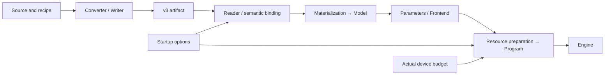

# NInferno Engine Architecture

This document defines NInferno's model instance, execution ownership, and top-level control plane, and explains how weights enter the fixed model implementation and how requests, resources, and output are committed together. It is the maintainer authority for the global architecture, the request lifecycle, and cross-module commit relationships.

This document specifies only long-term stable boundaries:

- who owns requests, ordering, cache policy, and physical state;
- how architecture code, instance configuration, weight representation, and actual execution connect;
- which stable states a request transitions between;
- when model state, output state, and resource state may be published externally;
- how cancellation and failure reach a unique terminal state.

Resource selection and context cache policy are defined by
[Resource Scheduling and Context Cache](resource-scheduling-and-context-cache.md); KV pages, replicas, block tables,
and the consumer contract are defined by [Paged KV Context Store](paged-kv-cache.md).

---

## 1. Product Execution Model

The Generation-purpose NInferno Engine runs with a fixed configuration of:

- one GPU;
- one resident model instance;
- `max_concurrency=1..8`, fixed at startup;
- one bounded FIFO waiting queue;
- an activated request is preempted only by the KV lease (`kv_lease_window`): when a lease
  cannot grow, the request admitted last leaves its lane and resumes from its text;
- each decode round forms one compact batch of all decode-ready requests.

Text, Vision, prefix reuse, MTP, DFlash/DFlash2, CLI, and HTTP serving all go through the public `ninferno::Engine` path.
MTP, DFlash, and DFlash2 are execution backends inside the Program; they do not introduce a second request scheduling or result publication mechanism.
An artifact must provide Text; the private weights and resources of Vision, MTP, DFlash, and DFlash2 may be absent.
Startup selects Vision, and none or one spec backend, independently, and binds and prepares resources only for the selected features and their shared dependencies.

The same public Engine also provides the CausalScoring purpose, fixed at startup. It serves offline text scoring only:
`CausalScoreCore` calls the Program serially, windows use temporary empty State and Main KV, and it creates no request, continuation,
checkpoint, or cache replica, and does not enter the Scheduler/ResourceManager. Generation and CausalScoring
do not switch at runtime, and scoring-specific staging is allocated only when CausalScoring starts.

`max_concurrency` limits the number of simultaneously active requests; it does not split shared KV capacity evenly among lanes. A request enters Active only after the Program
has proven that its complete execution resources are guaranteed; once Active, it does not lose the ability to complete because of another request or
the retention of an inactive cache.

This document does not cover multi-GPU placement, active request preemption, priority/QoS, cross-Engine context stores,
or large-scale continuous batching. Those workloads require redefining the admission and fairness contracts and cannot be extrapolated directly from the current
low-concurrency model.

### 1.1 Architecture and Weight Instance

Model code owns the mathematical formulas, call order, component handoffs, and state transitions. Config supplies instance parameters such as layer count, dimensions, Attention/GDN
distribution, and expert geometry. The current standard architecture entries are `Qwen3_5ForCausalLM` and
`Qwen3_5MoeForCausalLM`; trained instances and physical weight allocation enter the corresponding implementation as data.

A V3 artifact stores the configuration, physical objects, Bindings of logical parameters, Uses at usage sites, and Frontend resources.
The Converter handles source mapping, quantizing or value-preserving import, fused storage, packing, and layout conversion; the loader verifies against the actual bindings,
reads, and uploads the raw bytes. For the same architecture and a processable configuration, swapping trained weights or combining existing representations reuses the same model code.



`metadata.name` provides the public instance name, defaulting to the architecture name; serving may override the public alias with `--model-id`.
These names and the conversion provenance are used to identify the data and its source. Execution choices depend on the architecture, configuration, and actual bindings.

For the file and reference contracts see the [container specification](artifact-container.md); for the numerical interpretation and planes of weights see
[numeric formats](tensor-formats.md) and [storage layouts](storage-layouts.md) respectively.

---

## 2. Four Execution Boundaries

The request path has exactly four layers:

```text
Gateway
  │ product/protocol input
  ▼
Frontend
  │ PreparedPrompt / OutputSession
  ▼
Engine
  │ request order / lifecycle / publication
  ▼
Program
    physical resources / model execution
```

### 2.1 Gateway

The Gateway is the CLI, HTTP server, or another product entry point, and owns:

- protocol parsing, connections, and the streaming transport;
- conversion of messages, tools, and media into public input;
- URL, path, and data acquisition;
- response schema, usage, and product-side errors;
- the Gateway's own concurrency and connection lifecycle.

The Gateway does not choose request order, cache source, active lane, or KV page.

### 2.2 Frontend

The Frontend owns the model family's input and output semantics:

- tokenizer, chat template, Vision preprocessing, and MRoPE prompt construction;
- the owning `PreparedPrompt` and its content identity;
- stop, thinking/content channels, detokenization, final text, and model-private structured output;
- prefix-execution boundaries in model output that the history renderer can reconstruct exactly;
- the per-request exclusive `OutputSession`.

The Frontend may preview the semantic effect that a model output will produce, but may publish that effect only after the Engine has completed the commit.
The Frontend does not own the waiting queue, the cache catalog, or physical model state.

### 2.3 Engine

The Engine is the request control plane and owns:

- outstanding capacity, the FIFO queue, and request deadlines;
- the request record, active slots, cancellation, and response events;
- the Scheduler and ResourceManager;
- orchestration of admission, prefill, decode, control, capture, and terminal handling;
- the ordering of model commit, output commit, and response publication;
- Engine-wide failure cleanup;
- Engine availability readable by the Gateway; the fact itself remains owned solely by EngineCore's failure/lifecycle state.

The Engine understands requests, budgets, finish reasons, and publishable output; it does not interpret transformer layers, KV planes, or the allocator.

### 2.4 Program

The Program is the physical execution entry of the model instance and owns:

- active sequences and the complete continuation state;
- State/KV stores, the allocator, replicas, references, and reservations;
- prefill, ordinary decode, MTP/DFlash/DFlash2, and forced control;
- provisional model state and accepted-prefix commit/rollback;
- resident prefix identity, shortlist digest, and committed execution provenance;
- resource feasibility, physical transitions, and `ResourceResult`;
- workspace, CUDA Graph, and fixed model calls;
- temporary State/KV and `lm_head`/logprob staging for CausalScoring windows.

The Program does not maintain the FIFO, SessionIndex, cache retention value, or user-visible output.

---

## 3. Sole Ownership

| Fact or decision | Sole owner |
|---|---|
| config, bindings, Uses, weight backing, and read-only resources | Model |
| Native execution parameters derived from the bindings | const Parameters of ModelInstance; borrow from Model |
| Protocol, connections, transport | Gateway |
| Prompt and output semantics | Frontend |
| Waiting queue, request record, response event | EngineCore |
| Engine availability | EngineCore; the Gateway only reads it and maps it to external readiness |
| FIFO head, backfill, prefill/decode order, round membership | Scheduler |
| Logical lane, cache catalog, session binding, retention policy | ResourceManager |
| Model-output reconstruction-boundary semantics and preview state | Frontend |
| Committed resident prefix execution provenance | Program; the Engine only verifies and carries the metadata |
| Physical State/KV, reservation, placement, model state | Program |

Other components may read the stable summary published by the owner, but may not keep an independently mutable copy of the same kind of state.

### 3.1 Scheduler: Decides Only "Who Runs When"

The Scheduler maintains:

- the current FIFO head;
- the staged-prefill owner;
- the fairness gates among admission, prefill, and decode;
- the compact execution members of each round;
- backfill protection for a blocked head.

The Scheduler does not read checkpoint payloads, victim lists, resource vectors, or allocator state.

### 3.2 ResourceManager: Decides Only "Which Logical Context to Retain"

The ResourceManager maintains:

- logical lane state;
- the private/shared checkpoint catalog;
- the SessionIndex and the prefix candidate index;
- retention classes, hit observations, and logical claims;
- cache policy for admission, capture, and finish.

It hands requests and cache candidates to the Program for evaluation and adopts the complete physical result the Program returns. It does not maintain a mirror of
Device/Host bytes, page refcounts, or allocator free space.

### 3.3 Program: Decides Only "Whether and How Execution Is Physically Possible"

The real stores and allocators inside the Program are the sole authority for physical facts. The Program:

- computes occupancy, sharing, reclamation, and per-stage peaks from the complete candidate terminal state;
- seals an opaque `ResourcePlan` bound to the current `resource_revision`;
- executes the single physical transition;
- returns a complete result sufficient for the ResourceManager to update the logical catalog.

The Program does not decide cache value from the session, FIFO position, or user identity.

### 3.4 Model Instance and Engine Lifetime

The Engine interprets the logical requirements of the selected features according to the standard architecture/config, and the binder maps them to the artifact's objects and Uses.
The Materializer establishes stable backing and uploads the raw bytes, producing the read-only Model. The ModelInstance holds the Model,
forms const Parameters from it, and hands read-only resources such as the resolved tokenizer to the Frontend.

The Planner and actual execution borrow the same Parameters. The Planner queries the requirements of each layer and the selected backends according to the startup scope,
builds the capacity curve of each rung of the declared plan ladder, takes the first rung the Device memory remaining after weight residency fits ([plan levels](deterministic-decisions.md#plan-levels)), and then constructs the Program's final layout.
GenerationCore or CausalScoreCore uses it once instance preparation is complete.

Model configuration, bindings, and weight addresses are fixed for the lifetime of the instance; each Program exclusively owns its mutable State/KV,
workspace, and Graph. On teardown, the Engine core and outstanding device work end first, then the instance's Program,
Frontend, and Parameters are destroyed, and finally the Model backing is released. The Reader and upload staging belong to the loading lifecycle.

Weights, State/KV backing, block-table matrices, workspace, and CUDA Graph resources are established before the Engine starts accepting requests.
At runtime, ownership, mapping, frontier, and replica placement change, but these large Device allocations are not rebuilt.

### 3.5 Fixed Execution and Native Parameters

The number of logical parameters, physical objects, and Op parameters is determined by the math, the storage, and the actual entry point respectively. For example, two currently implemented
forms of the Dense Attention projection:

| Actual binding | Fixed model call |
|---|---|
| One Q4 parent stores Q/K, another Q5 parent stores gate/V | Prepare two weight parameters and use the dual-weight projection entry |
| One complete FP8 or NVFP4 parent stores Q/K/gate/V in order | Prepare one weight parameter and use the single-weight projection entry |

A View preserves the complete parent's geometry, planes, and element range; native preparation interprets these references as the entry point requires.
A shared object is resident once, and each usage site keeps its own Use. Activation permissions are `A16Only={A16}`,
`AllowA8={A16,A8}`, `AllowA4={A16,A8,A4}`; a fused call takes the intersection of the permissions of the relevant Uses and handles the required auxiliary values.

Model code directly maintains the finite call forms, cross-Op fusion, and stage relationships; a closed computation and its shape/format dispatch belong to the Op.
The Reader, binder, native parameter preparation, capacity query, warmup, and actual execution each check the contract they consume.
The executable range of a valid artifact is determined by the actual consumers; conversion does not require the complete weight combination to be registered in advance.

The math formulas, the weight representation values, and the implementation precision are interpreted separately. Different quantization, prefill, batch, or speculative routes may
produce different results; numerical and state correctness is verified against the [Op contract](op-development.md) and the corresponding independent oracle.

---

## 4. Request and Resource Lifecycle

### 4.1 Request States

A request advances through the following stable states:

```text
Waiting
  -> Materializing
  -> Prefill
  -> DecodeReady | ControlReady
  -> TerminalPending
  -> Finished
```

- **Waiting**: only the owning prompt and output state exist; there is no Program sequence.
- **Materializing**: the resource transition has acquired its logical claim; the source remains valid until commit or abort.
- **Prefill**: the request is already Active and is consuming the prompt suffix.
- **DecodeReady**: may join the next compact decode round.
- **ControlReady**: the Frontend requires committing the canonical forced-control suffix.
- **TerminalPending**: model execution has terminated, but the active resources have not yet completed retain or release.
- **Finished**: resources and output are both committed, and the response may complete.

### 4.2 Logical Lane States

The ResourceManager's lane states are:

```text
Free -> Materializing -> Active -> TerminalPending -> Free
```

A request may enter Active only after both the physical result and the logical result of materialization have been adopted successfully. A terminal request
must retain active ownership until the complete checkpoint is published or all active resources are released.
For a streaming request, `GenerationStart` is published once, after admission selects the commit and before any output delta; the
prompt tokens and reused-prefix tokens it carries are committed resource-selection facts and do not wait for prefill to complete.

Control lane, StateImage slot, KV execution row, and decode batch row are distinct identities:

- a lane is the Engine's long-lived active request position;
- State/KV execution resources are allocated by the Program;
- a compact row is merely the ordinal of the current GPU unit.

They must not derive ownership from one another.

### 4.3 Gateway and Engine Capacity

The Gateway may acquire its own request lifetime before prepare or media acquisition. Engine outstanding capacity
starts from the successful submit of a request with nonzero output and is released by two independent facts together:

```text
response_done       the worker has formed the final result or error
consumer_released   the wait has ended, or the GenerationHandle was abandoned

release_capacity =
    response_done && consumer_released && !capacity_released
```

The two may occur in either order, but the capacity is released only once. Abandoning the request handle only sets cancellation and
`consumer_released`; it never calls the Program from the consumer thread.

### 4.4 Continuation and Session

An Active continuation is writable model state; a published checkpoint is immutable, reusable state. A reusable
checkpoint must prove the complete State, Main KV, selected backend KV, and the metadata needed to resume execution at the same frontier.

A session key is only a lookup hint and does not own a continuation. Each request receives a monotonic
`publication_order` when it enters the Engine; only a completed result with a later order may replace the SessionIndex binding.

---

## 5. Worker and Scheduling

### 5.1 Single Mutation Owner

Only the Engine worker modifies the request record, Scheduler, ResourceManager, and Program. Ingress, consumer,
and transport threads interact through queues, cancellation flags, and response events and never change model state directly.

One worker boundary processes, in semantic order:

1. receive the timeout or cancellation of waiting requests;
2. advance resource transitions that have already started;
3. complete TerminalPending requests that can be settled;
4. freeze the active cancellation snapshot;
5. attempt one admission when the fairness gate allows;
6. select staged prefill, forced control, or compact decode;
7. run at most one model execution unit;
8. commit model, budget, and Frontend output state;
9. publish response events and observations.

The concrete loop decomposition may change, but the following order may not:

- an in-flight GPU unit must reach a stable boundary before its resource mapping is modified;
- the Program commit must precede user output publication;
- the resource result must be adopted before the lane changes its visible state;
- while one global resource topology transition is unsettled, no other transition is started.

### 5.2 Admission Order

The Scheduler first determines the single waiting request that may be attempted, and the ResourceManager then chooses the cache and resource terminal state for it.
Resource conditions may not in turn change FIFO ownership.

When the FIFO head is temporarily blocked by active incumbents, the Scheduler records the protected head and the donor set that must finish.
A later request may backfill only if the Program proves the following:

> After the borrower keeps occupying its complete active reservation, finishing the given donor set is still sufficient for the head to enter with a
> root-sourced plan that releases all inactive caches.

This proof does not use a "borrower is expected to finish first" timing assumption. A transition that changes the global resource topology advances
`resource_revision`, after which backfill must be proven again.

### 5.3 Prefill and Decode

The Scheduler guarantees:

- at most one staged-prefill request at a time;
- existing decode work is not starved by consecutive prefills; under `--concurrent-prefill` every active request gets an
  equal share of predicted GPU time (`interleave_cost.h`): a prefill unit, priced by the context machine cost model from
  its own work (calls, tokens, attention pairs from its start position, the images it encoded), owes the D decoding lanes
  D/`prefilling` of its price, and each decode round pays its own price from its shape: per step the larger of the call's
  fixed cost and one read of the weights its tokens touch (32 prompt tokens' worth for the active weights; a MoE step of
  L lanes touches an expected 1 − (1 − k/E)^L of each layer's routed experts), one prompt token of compute per token, and
  16 prefill attention pairs per context token of every token; times the round's steps (16 under a CPU quota, or
  `--decode-steps`). A speculative round is one step of depth + 1 tokens per lane. The interleaving, and so each round's batch, is priced, never timed. At concurrency 8 a
  long prompt's predicted time to first token is about eight times its prefill time, as under the former timed share;
- a decode round contains all and only the currently decode-ready requests;
- the batch uses the exact `B` and is not padded with inactive lanes up to `max_concurrency`.

The Program receives a compact `SequenceHandle[B]` and a per-row budget. Prefix reuse only reduces materialization or suffix
prefill and does not create another scheduling path.

### 5.4 Admission Invalidation

Only facts that can change the admission conclusion re-trigger the check:

- the waiting queue or the FIFO head changes;
- a lane is released;
- the staged-prefill gate changes;
- a resource transition reaches a terminal state;
- the Program's global resource revision changes.

Ordinary decode frontier advance, output publication, and statistics updates neither scan the cache catalog nor rerun the pressure planner.

---

## 6. Two Kinds of Commit Transactions

The Engine orchestrates two kinds of transactions across modules, and neither substitutes for the other.

### 6.1 Resource Transition

A resource transition changes global resources or ownership at these boundaries:

- waiting request materialization;
- active checkpoint capture;
- terminal retain or release;
- placement or deletion of an inactive checkpoint.

Paths that need planning, allocation, or transfer follow:

```text
logical choice
  -> Program seals ResourcePlan
  -> RunningTransaction
  -> ResourceResult
  -> ResourceManager adopts result
```

A `ResourcePlan` is bound to the Program's `resource_revision`. A plan that is stale before Start may be replanned without side effects;
after start, the source, victims, or stage order cannot be replaced. Abort must also return a complete terminal state, so that every claim, pin, and committed
safe downgrade has a unique interpretation.

Resource candidates, feasibility formulas, the cost model, and bounded search are defined by
[Resource Scheduling and Context Cache](resource-scheduling-and-context-cache.md).

### 6.2 Model-unit Transaction

Prefill finalization, decode, and control execution may produce a move-only `PendingBatch`:

```text
frozen sequence membership
provisional tokens
per-row produced extent
per-row accepted-prefix execution metadata
Program-owned provisional state
```

The Engine performs a Frontend preview of each row's output, forms the accepted-prefix decision, and then consumes the whole batch with a single
`Program::commit` or `Program::abort_pending`. The Program commits or rolls back together the Main/backend KV, recurrent state, RNG, and speculative state
corresponding to that prefix.

Non-cancelled rows follow:

```text
1 <= accepted_tokens <= produced_tokens
nonterminal -> accepted_tokens == produced_tokens
terminal    -> accepted_tokens may be a produced prefix
```

A cancelled row uses zero accepted tokens and enters terminal. The Engine does not allow abandoning a still-unconsumed
`PendingBatch` row by row.

### 6.3 Output Publication Order

The visible order of one model output is:

```text
Frontend preview
  -> Program commits accepted model state and resident prefix execution provenance
  -> terminal resource result, when required
  -> generation budget and scheduler accounting
  -> OutputSession commits preview
  -> publish stream/aggregate event
```

Hence the consumer never sees a token that has not been committed, nor a continuation inconsistent with the Program frontier.
Forced control uses the same commit order, but the tokens are supplied by the Frontend, no sampler is called, and the sampling RNG is not advanced.

Boundary metadata produced by the Frontend describes only relative positions within the current accepted span. The Engine verifies that it falls within that span and carries it with the
corresponding row; it does not interpret delimiters and does not modify resident identity. The Program uses the pending row's base frontier to
convert it to absolute positions and commits it atomically with the accepted tokens, the Main/backend state, and the prefix digest. If the Program commit fails,
the `OutputSession` preview state is likewise not committed; ordinary, MTP, DFlash, and forced control share this ownership chain.

---

## 7. Terminal, Cancellation, and Failure

### 7.1 Terminal

An Active request that terminates successfully first enters TerminalPending:

```text
choose retain or release
  -> Program publishes one complete checkpoint or releases the sequence
  -> ResourceManager adopts the terminal result
  -> optional SessionIndex update
  -> lane becomes Free
```

The checkpoint's logical publication slot is already reserved at activation. If retention cannot form a complete continuation,
the deterministic terminal state is release, rather than leaving the request in TerminalPending.

### 7.2 Cancellation

Cancellation takes effect at a stable boundary of the Engine worker:

| State when cancellation is observed | Result |
|---|---|
| Waiting | No Program state is created; the request ends directly |
| Materializing | Abort the resource transition and adopt its complete result |
| Active | After the current GPU unit stabilizes, enter TerminalPending and release |
| PendingBatch | Commit via a cancelled row decision, or abort the whole batch |
| Already committed, not yet adopted | Adopt the committed result first, then take the terminal path |

Cancellation neither modifies an in-flight mapping nor publishes a checkpoint from incomplete active state.

### 7.3 Request-local Rejection

Before any Program mutation, only the current request may be rejected:

- queue timeout, overload, or waiting cancellation;
- input exceeding the public context contract;
- a prompt or generation request that cannot be represented;
- the single request is still infeasible even with a root source and with all inactive caches released.

### 7.4 Engine-wide Failure

The following situations mean the shared physical state can no longer be safely interpreted and the entire Engine must fail:

- after a GPU mutation, neither commit nor a stable abort is possible;
- `PendingBatch` membership or disposition is inconsistent;
- handle owner/generation mismatch;
- a resource, checkpoint completeness, or noexcept adoption invariant is violated.

Cleanup order must first terminate the Program's outstanding resource/model transactions, then release active state, and finally clear the
ResourceManager and complete all request responses. An internal invariant error must not be downgraded into a cache miss, a wait, or a retry.

---

## 8. Top-level Constraints on Physical Execution

The following constraints belong to the Engine architecture, while the concrete implementation is defined by the Program and lower-level documents:

- the Program establishes a fixed number of control/state/table resources at startup;
- growing KV is backed by shared paged pools, and an active request holds its complete growth reservation;
- State/KV mapping stays stable within one GPU execution unit;
- CUDA Graphs are built per legal exact-`B` topology; request identity and page IDs are stable input data, not graph keys;
- ordinary decode runs no catalog scan, pressure search, or background replica scan;
- ordinary decode runs one step per execution unit, or 16 when the process's CPU bandwidth quota is below min(4, logical cores) CPUs (machine facts read once at startup:
  the tightest cgroup `cpu.max` or `cpu.cfs_quota_us` along the process's cgroup and its parents; a container's quota stalls the whole process until the next quota period); `--decode-steps N` replaces
  that default. The count never follows a timing, since it decides which requests share each step's batch (`round_pacing.h`); the startup log and the
  load summary report it. Several steps run back to back within one execution unit:
  later steps take the previous step's sampled result as input on the device. This applies only to models in which rows that were executed but not committed are invisible to later rows
  (`ModelExecution::uncommitted_row_limit`: no recurrent state, and the sliding ring has headroom); non-terminal
  rows commit all steps, and terminal rows commit only the accepted prefix;
- during host lag, when waiting for a round to end (ordinary rounds and speculative rounds; the latter run only one verify per round and
  do not run several steps back to back), the engine probes both spinning and blocking on the blocking-sync stop event (each for at least 1 second and
  8 rounds, at most 3 seconds; on the first lag it probes spin first, afterwards it probes the retained method first), and blocks for the following 30 seconds only if
  blocking yields at least 3% more steps per second (a speculative round counts as one step, regardless of the number of accepted drafts); if the rate of the retained
  method changes by more than 50%, it re-probes immediately (`--decode-wait`). The round timer starts on an idle stream before the round's first
  launch (including the host preparation of a speculative launch), and lag counts only late wake-ups from the wait: blocking is usually better, because spinning exhausts the CPU quota; under extremely heavy load
  a blocked host may wake too late, and spinning is better;
- the workspace is a backing planned uniformly at Program startup; the Vision, Text, and speculative schedules use its internal regions
  with mutually exclusive lifetimes.

An Op owns Graph update compatibility within its declared execution scope; the Program captures the complete execution unit and validates updates of the same kind
at startup. Length tiers are used to bound reserved resources and are not the same as topology classes. The Program does not duplicate the private kernel dispatch boundary of target attention;
the actual topology requirements of other Ops such as the draft are still handled separately by the complete execution unit.

Capacity queries consume the per-layer parameters, Uses, and device capacity information from the same source as execution. The allocation scope is used for both layout computation and actual execution;
sequentially exclusive scratch takes the peak, and data that stays live across stages counts for its full lifetime. The Vision handoff is retained until the last consumer in Text
and the selected MTP, and speculative pending features and verify records are retained until the corresponding commit boundary.

Prefill cost selects measured values by the device's GPU class (along its class chain, else the nearest measured board within the carry distance) and a `prefill_signature` derived from the actual Text/Vision configuration, bindings, and Uses;
when no match exists a generic cost is used. The cost is used for planning choices, while physical feasibility is still determined by the Program's actual layout and occupancy.

Serve warmup uses the same public Engine execution path, but its request-level context cache is fixed off. Warmup may establish the runtime state of
CUDA Graphs, libraries, and the allocator, and after it ends must leave behind no continuation that external requests could hit and no occupied
checkpoint catalog entries.

---

## 9. Core Invariants

1. Request order is decided only by the Scheduler.
2. Logical cache policy is decided only by the ResourceManager.
3. Physical occupancy, reservation, feasibility, and model state are decided only by the Program.
4. A complete continuation and a completed reservation must exist before Active publication.
5. At any moment there is at most one global resource topology transition.
6. A `PendingBatch` must be fully consumed by a single Program commit or abort.
7. Model output becomes visible to the consumer only after the Program, Frontend, and budget have all committed.
8. A request's active ownership must not be released or reused before TerminalPending ends.
9. Cancellation may change request state only at a linearized worker boundary.
10. Every accepted request, resource transaction, and model transaction has a finite and unique terminal state.

---

## 10. Implementation Locations and Adjacent Authorities

| Responsibility | Primary location |
|---|---|
| Public Engine facade | `include/ninferno/engine.h`, `src/runtime/engine/engine.cpp` |
| Engine worker and request lifecycle | `src/runtime/engine/engine_core.h`, `src/runtime/engine/request_record.h` |
| Scheduler | `src/runtime/engine/scheduler.h`, `admission_policy.*` |
| Instance construction and lifetime | `src/runtime/engine/model_instance.*` |
| ResourceManager and materialization planner | `src/runtime/engine/context_cache/` |
| Request, execution, resource, and timing contracts | `src/runtime/contract/` |
| Model config, bindings, and read-only data | `src/models/qwen3_5/config.*`, `load/`, `model.*` |
| Native parameters and fixed model calls | `src/models/qwen3_5/execution/` |
| Program planning, storage, and transactions | `src/models/qwen3_5/program/` |
| Frontend and model state layout | `src/models/qwen3_5/frontend/`, `state/` |
| device primitives, tensors/views, checked layouts, arenas, graph RAII, physical KV, raw transfers | `src/core/` |
| generic `.ninferno` framing, descriptors, binding primitives, materialization | `src/artifact/` |
| semantic Ops | `src/ops/`, `include/ninferno/ops/` |
| shared JSON/message-to-owning-input adapter | `src/product/prompt_input/` |
| media URL/path/data acquisition | `src/product/media_acquire/`, CLI and serving |
| media decode from already-owned bytes | `src/media/decode/` |
| HTTP Gateway | `src/serve/` |
| Source adapters, recipes, and conversion methods | `tools/convert/` |
| Python container reading, encoded output, and writer | `tools/artifact/` |

These paths serve to locate the current authority and do not freeze the file split as an external interface.

`include/ninferno/engine.h` and `include/ninferno/types.h` are the opaque Engine
interface and owning host values used by in-tree applications; NInferno does not currently install or export a C++ SDK. `include/ninferno/ops/` contains
repository-internal semantic Op contracts. `.ninferno` is the only C++ product artifact; other formats are not loaded through extension detection,
compatibility shims, or a second product entry point. The CLI, server, and inference benchmarks run inference only through the public Engine;
the converter provides no Python model-inference route.

The Artifact layer owns the generic file and residency contracts, the model implementation owns the math and state operations, the runtime owns the public runtime contract and
Engine publication policy, and product/serving owns input acquisition and protocol translation. Every semantically closed Op (including fused,
fixed-shape, and device-specialized implementations) belongs to `src/ops`.

Adjacent documents:

- [Resource Scheduling and Context Cache](resource-scheduling-and-context-cache.md): resource vector, checkpoint
  capability, pressure planning, and physical transition;
- [Paged KV Context Store](paged-kv-cache.md): typed pools, logical pages, replicas, block tables,
  and the consumer address contract;
- [Op development](op-development.md): Op correctness and performance admission;
- [CLI](../cli.md) and [HTTP serving](../serving.md): external behavior.
