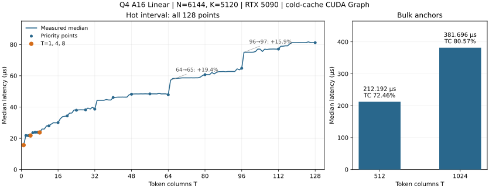

# Q4 Linear Performance Report: N=6144, K=5120

Re-measured on 2026-09-26. This document records the full Linear Op performance after this phase's cleanup, for evaluating this shape and for later tuning.

## Measurement Target and Conditions

| Item | This measurement |
|---|---|
| Weights | `Q4_G64_FP16`, row-split layout; every 64 weights share one FP16 scale |
| Math shape | `W[6144,5120] × X[5120,T] → Y[6144,T]` |
| Input, output and policy | BF16 input, BF16 output, `A16Only` |
| GPU / driver | NVIDIA GeForce RTX 5090; 617.14 |
| Build / CUDA | Release, `sm_120a`; runtime library 13.4, benchmark compiled with `CUDART_VERSION=13010` |
| Timing entry | `ninferno::ops::linear`; each CUDA Graph contains one complete Op call |
| Cache / sampling | 256 MiB L2 flushed before each sample; 5 warmups, 30 measurements, median reported |
| Input fixture | Public bench Q4 packed-weight and BF16 activation fixture; numerical validation uses separate non-uniform weights and scales |
| Coverage | Every integer T=1–128, plus 512 and 1024; 130 points in total |

Every measured call has exactly one Graph kernel node and zero external workspace. The measurement scope is the pure Linear Op.
This run reused incremental build artifacts; `cuda_runtime` in the bench log comes from the compile-time macro, and the actually loaded runtime library version is queried separately.

## Final Latency Curve



The left plot contains all 128 measured points; dots mark the key T values, and orange highlights T=1, 4, 8; lines connect only adjacent measured points.
The right plot shows 512 and 1024 separately; the TC percentage uses the logical-throughput definition below.

## Logical Bandwidth and Tensor Core Utilization

The weights contain `6144 × 5120 / 64 × 34 = 16,711,680` bytes of codes and scales.
Following the [Linear bench metric definitions](../linear-benchmark.md#5-math-workload-and-route-neutral-metrics):

```text
model_bytes = 16,711,680 + 2 × 5120 × T + 2 × 6144 × T
logical bandwidth GB/s = model_bytes / seconds / 1e9
bandwidth utilization = logical bandwidth / 1792 GB/s × 100%

effective throughput TFLOP/s = 2 × 6144 × 5120 × T / seconds / 1e12
TC utilization = effective throughput / 209.5 TFLOP/s × 100%
```

The denominators come from the bench's fixed RTX 5090 spec constants. T=1 uses GEMV, so TC utilization is `—`;
all current paths for T≥2 use dense MMA with BF16 input and FP32 accumulation, matching the **209.5 TFLOP/s** peak.
The bench's Q4 rows leave the TC fields empty; this document backfills them with the formulas above, without adding decode, padding, or extra tile work.
These are utilizations under the logical-workload definition, not hardware-counter measurements, and the remaining percentage is not all recoverable time.

At T=1 the logical bandwidth is **1069.4 GB/s, a nominal bandwidth utilization of 59.68%**; against the
1674.5 GB/s sustained-read reference that the bench lists separately it is **63.86%**, corresponding to the `READ_%` definition.

| T | Latency µs | Logical bandwidth GB/s | Bandwidth utilization | Effective throughput TFLOP/s | TC utilization |
|---:|---:|---:|---:|---:|---:|
| 1 | 15.648 | 1069.4 | 59.68% | 4.02 | — |
| 2 | 21.792 | 768.9 | 42.91% | 5.77 | 2.76% |
| 3 | 21.696 | 773.4 | 43.16% | 8.70 | 4.15% |
| 4 | 21.792 | 771.0 | 43.02% | 11.55 | 5.51% |
| 5 | 23.552 | 714.3 | 39.86% | 13.36 | 6.38% |
| 6 | 23.808 | 707.6 | 39.49% | 15.86 | 7.57% |
| 7 | 23.808 | 708.6 | 39.54% | 18.50 | 8.83% |
| 8 | 23.744 | 711.4 | 39.70% | 21.20 | 10.12% |
| 12 | 27.936 | 607.9 | 33.92% | 27.03 | 12.90% |
| 16 | 29.984 | 569.4 | 31.77% | 33.57 | 16.02% |
| 20 | 34.304 | 500.3 | 27.92% | 36.68 | 17.51% |
| 24 | 37.952 | 454.6 | 25.37% | 39.79 | 18.99% |
| 28 | 38.208 | 453.9 | 25.33% | 46.11 | 22.01% |
| 32 | 38.656 | 451.0 | 25.17% | 52.08 | 24.86% |
| 40 | 46.112 | 382.0 | 21.31% | 54.58 | 26.05% |
| 48 | 48.192 | 369.2 | 20.60% | 62.66 | 29.91% |
| 56 | 48.416 | 371.2 | 20.72% | 72.77 | 34.73% |
| 64 | 47.840 | 379.5 | 21.18% | 84.17 | 40.18% |
| 80 | 60.704 | 305.0 | 17.02% | 82.91 | 39.58% |
| 96 | 64.800 | 291.3 | 16.25% | 93.21 | 44.49% |
| 112 | 77.088 | 249.5 | 13.92% | 91.41 | 43.63% |
| 128 | 81.184 | 241.4 | 13.47% | 99.20 | 47.35% |
| 512 | 212.192 | 133.1 | 7.43% | 151.81 | 72.46% |
| 1024 | 381.696 | 104.2 | 5.82% | 168.78 | 80.57% |

## Curve Interpretation and Validation

The [shape implementation](../../../src/ops/linear/q4/shapes/n6144_k5120.cu) chooses among GEMV, in-CTA sliced-K, and plain MMA;
the source is authoritative for the exact configuration.

- T=1→2 rises from 15.648 to 21.792 µs (+39.26%), the largest adjacent jump in the hot region,
  corresponding to the switch from single-token GEMV to sliced-K.
- T=64→65 rises from 47.840 to 57.120 µs (+19.40%); T=96→97 rises from
  64.800 to 75.072 µs (+15.85%). These steps at production-route boundaries remain.
  There are also steps within a single route, for example +14.57% at T=32→33; the plot keeps all measured changes.
- T=512 is **212.192 µs, 151.81 TFLOP/s, 72.46% TC utilization**;
  T=1024 is **381.696 µs, 168.78 TFLOP/s, 80.57% TC utilization**.
  This round re-measured only the two large-T anchors; 129–511 and other large-T boundaries were not re-measured.

Numerical qualification reuses `ninferno_linear_q4_a16_test`, which already passed in this phase: it independently decodes the packed Q4 codes and
FP16 scales, uses an FP64 matrix multiplication as the oracle, and, per the existing A16 standard, checks the public routes, representative boundaries, output guards,
input preservation, and CUDA Graph replay with changed inputs. This run refreshed only timing and documentation; the numerical tests were not re-run.

## Reproduction

```bash
cmake --build build -j --target ninferno_linear_bench

./build/bench/ninferno_linear_bench \
  --qtype q4 --policy a16 --n 6144 --k 5120 \
  --sweep 1:128:1 --execution graph --graph-calls 1 \
  --warmup 5 --repeat 30 --flush-mib 256 \
  --csv-out profiles/bench/q4_report_20260926/hot.csv
./build/bench/ninferno_linear_bench \
  --qtype q4 --policy a16 --n 6144 --k 5120 \
  --sweep 512:1024:512 --execution graph --graph-calls 1 \
  --warmup 5 --repeat 30 --flush-mib 256 \
  --csv-out profiles/bench/q4_report_20260926/bulk.csv
```

To continue tuning, follow the [Linear tuning and reporting specification](../linear-tuning.md) to choose candidates, validate numerics, and converge the dispatch.
This report describes only this shape under the measurement conditions above; it does not represent other shapes or end-to-end inference performance.
